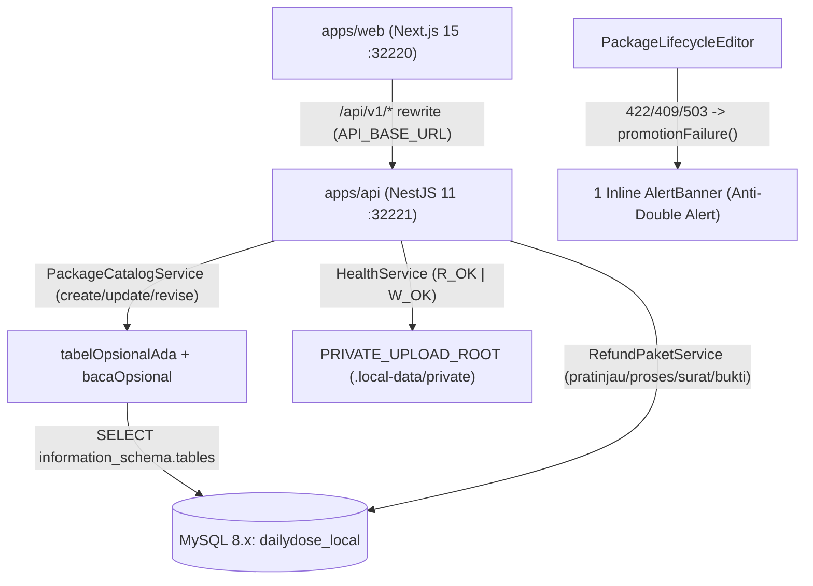
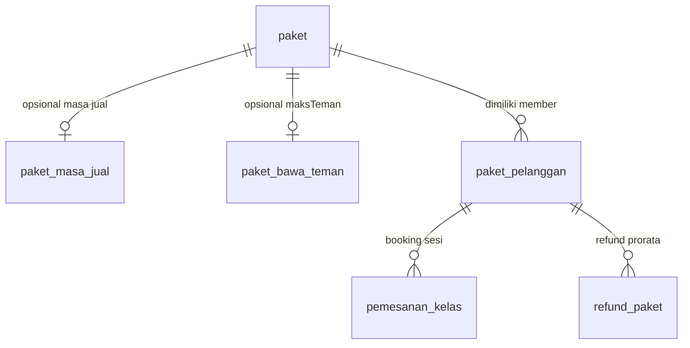

# Phase 0 & Phase 2: Brownfield Audit & Architecture Blueprint (Graphify)

**Proyek:** `dailydose-v2` (Daily Dose Pilates)  
**Mode:** `BROWNFIELD_CONTINUE_EXISTING` (`PROGRESSIVE_BOY_SCOUT_RULE`)  
**Tanggal Audit:** 2026-11-12  

---

## Step 1: Architecture & Dependency Scan

- **Monorepo:** `pnpm` workspace + `turbo` (`apps/api`, `apps/web`, `packages/config`, `packages/notification-core`, `packages/api-client-*`).
- **Backend (`apps/api`):** NestJS 11 + Prisma 6 + MySQL 8.x (`apps/api/prisma/schema.prisma`, tanpa folder `prisma/migrations`—sinkronisasi skema lokal memakai `prisma db push` / `db:fresh:seed`, sedangkan deployment production memakai SQL aditif di `docs/DEPLOY.md`).
- **Frontend (`apps/web`):** Next.js 15 (App Router) + React 19 + Tailwind CSS v4, meneruskan request `/api/v1/*` ke `API_BASE_URL` melalui `next.config.ts`.
- **Runtime & Storage Lokal (Non-Docker):**
  - Database: MySQL native lokal (`127.0.0.1:3306`, database `dailydose_local`).
  - Upload privat: `PRIVATE_UPLOAD_DRIVER=local` mengarah ke direktori lokal absolut agar lolos pengecekan `HealthService`.
  - Scanner bukti pembayaran: `PAYMENT_PROOF_SCAN_DRIVER=synthetic` (production menggunakan ClamAV).

---

## Step 2: Standards Compliance Gap Analysis (`sdlc-promax-kit`)

| Standar Kit | Kondisi Eksisting di `dailydose_v2` | Temuan Celah & Status Penanganan |
| :--- | :--- | :--- |
| **1. Data Lists & Pagination (`QA-01`)** | `packages-management-view.tsx` memakai `DataTable` + `Pagination` cursor server-side & filter URL query. | Modul paket patuh pada cursor pagination & pencarian URL; modul lain ditingkatkan progresif (*Boy Scout Rule*). |
| **2. Dynamic Select (`QA-02`)** | Menggunakan `SelectInput` berbasis `<select>` untuk pilihan statis kecil (mis. status efektif paket 5 opsi). | Modul baru atau dropdown relasional >5 opsi wajib memakai `AsyncSearchSelect` dari `docs/sdlc/ui-standards-reference`. |
| **3. Alert Deduplication (`QA-03`)** | Mayoritas drawer memakai 1 `AlertBanner` inline (`EditPackageModal`, `PromotionDrawer`); namun `PackageLifecycleEditor` pasca-merge sempat memunculkan `AlertBanner` **dan** `showToast` danger sekaligus. | **Diperbaiki (`Boy Scout Rule`):** toast ganda di `PackageLifecycleEditor` dihapus agar hanya tampil 1 alert actionable dengan konteks + penyebab + solusi. |
| **4. Confirmation Modal (`QA-04`, `QA-05`)** | Aksi kritikal melewati `feedback.confirm(...)` (`Escape` dismiss, fokus modal, loading lock). | Sudah selaras pada modul paket & alur konfirmasi 2 langkah pada modul refund (`refund-baru-view.tsx`). |
| **5. No Happy Path & Optional Table Guardrail (`QA-06..08`)** | `tabelOpsionalAda` di `apps/api/src/foundation/tabel-opsional.ts` memakai `SHOW TABLES LIKE ?` lewat `$queryRawUnsafe`. | **Bug P0 Diperbaiki:** MySQL menolak `?` di `SHOW TABLES` dengan error `1064` (`PATCH /packages` jadi `500`); diganti `SELECT 1 FROM information_schema.tables WHERE table_schema = DATABASE() AND table_name = ? LIMIT 1`. |
| **6. Cross-Platform Windows Dev Scripts** | `apps/web/package.json` `dev` memakai sintaks POSIX, `ports:clean` hardcode `32120`/`32121`, dan `tools/db-fresh.ts` + `fresh.ts` memakai path Windows non-URL pada `--import`. | **Diperbaiki:** Skrip dibuat lintas-platform (Windows + Unix) dan membaca port dari `.env` (`32220`/`32221`) tanpa mengganggu port `32120`/`32121`. |

---

## Step 3: Regression & Impact Mapping (Graphify — Mermaid)

### Alur Arsitektur Lokal & Proteksi Tabel Opsional

### Relasi Entitas Inti Modul Paket & Refund (`erDiagram`)

---

## Step 4: Progressive Refactoring Strategy (Boy Scout Rule)

1. Modul baru wajib memakai komponen fondasi di `docs/sdlc/ui-standards-reference` (`DataTablePagination`, `AsyncSearchSelect`, `alert-manager`, `ConfirmModal`).
2. Setiap modul lama yang disentuh wajib diaudit minimal terhadap 4 kontrak UI (`Pagination`, `Async Combobox` bila relasional >5 opsi, `Single Deduplicated Alert`, `Confirm Modal`).
3. Tidak ada klaim selesai atau rekomendasi perintah CLI tanpa eksekusi langsung pasca-edit terakhir dengan bukti nyata.

